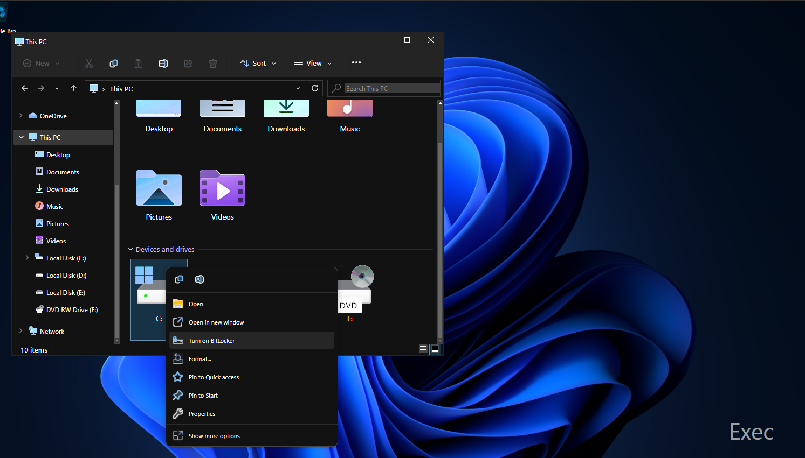
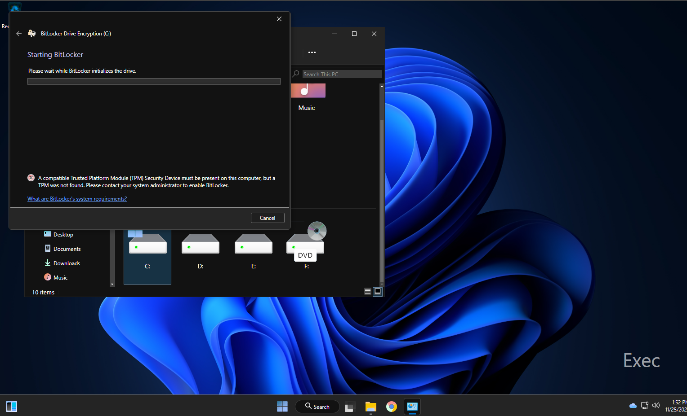
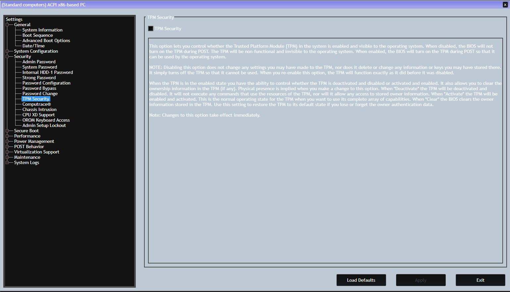
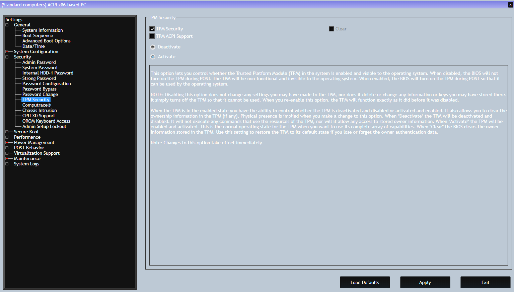
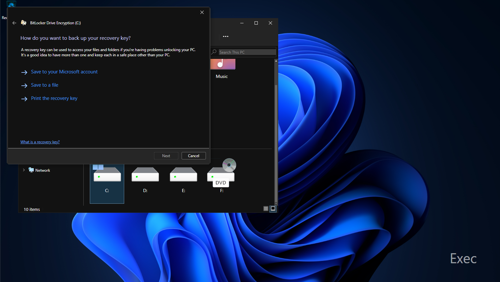
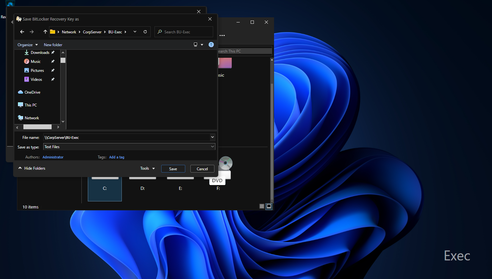
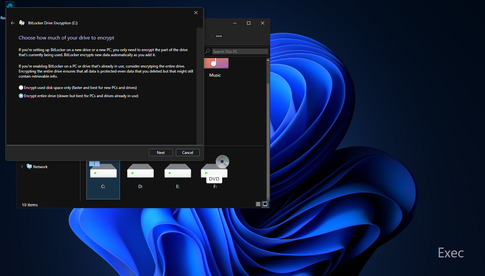
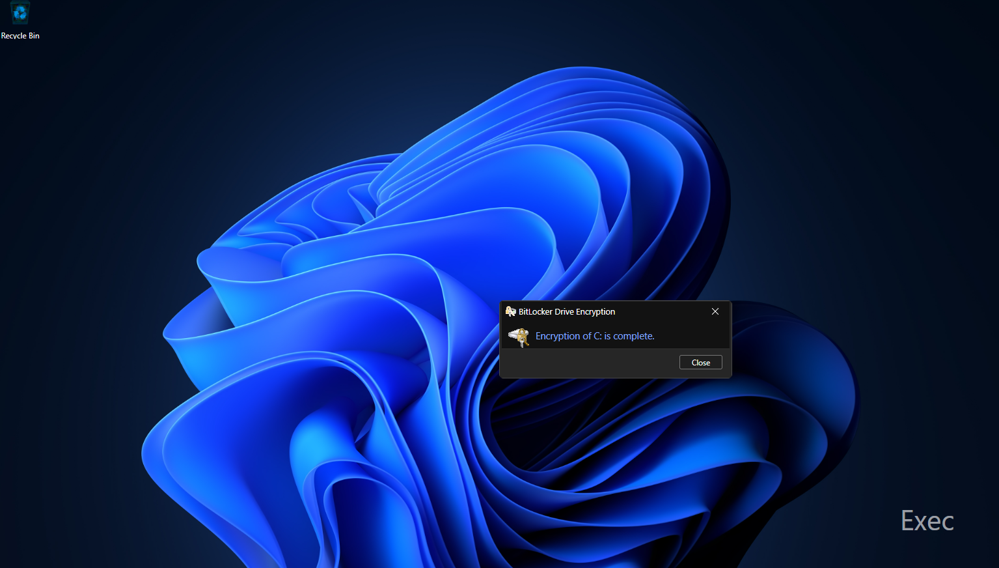

# BitLocker TPM Activation

A CompTIA Security+ course lab (3.2.5) completed in a simulated Windows environment. The course lists this lab as "Encrypt Files with EFS," but the hands-on task is enabling and activating the TPM on the Exec computer, then turning on BitLocker for the System (C:) drive.

## Summary

Acting as the security analyst for a small corporate network, I was asked to encrypt the System volume on the Exec computer so that sensitive company information would not be exposed if the drive were stolen. The lab states that Exec has a built-in TPM on the motherboard.

In the Exec virtual machine I opened File Explorer, went to This PC, right-clicked the C: drive, and chose Turn on BitLocker. BitLocker did not start. It reported that a compatible TPM security device must be present, but a TPM was not found. I answered the lab question that BitLocker could not start because the TPM was not enabled.

I opened the BIOS, went to Security, then TPM Security. TPM Security was unchecked, so the TPM was not visible to the operating system. I checked TPM Security, selected Activate, applied the change, and exited the BIOS. I then turned on BitLocker for C: again, saved the recovery key to a file in `\\CorpServer\BU-Exec`, chose Encrypt entire drive, ran the BitLocker system check, and restarted. After the restart, BitLocker reported "Encryption of C: is complete."

## My Role

I completed this hands-on in CompTIA's lab on November 25, 2026. I diagnosed why BitLocker would not start on Exec, enabled and activated the TPM in the BIOS, then configured BitLocker drive encryption on the System (C:) volume and chose where to store the recovery key. Exec, CorpServer, and the BU-Exec share are part of the course lab, not a real workplace or my own network. The write-up is my own.

## Evidence

### Turn on BitLocker for C:

On the Exec computer I opened This PC, right-clicked the C: drive, and chose Turn on BitLocker.

### BitLocker could not start: TPM not found

The BitLocker wizard stayed on Starting BitLocker and reported that a compatible Trusted Platform Module (TPM) security device must be present on this computer, but a TPM was not found.

### BIOS TPM Security disabled

In the BIOS I opened Settings, Security, TPM Security. The TPM Security checkbox was cleared, so the BIOS would not turn on the TPM during POST and the operating system could not use it.

### TPM enabled and activated

I checked TPM Security and selected Activate, then applied the change and exited the BIOS.

### Recovery key backup options

After I turned on BitLocker for C: again, the wizard asked how to back up the recovery key. I chose Save to a file so the key would be stored off the same PC, not only on the drive being encrypted.

### Recovery key saved to \\CorpServer\BU-Exec

I navigated the save dialog to the `\\CorpServer\BU-Exec` network folder, which appears in the address bar as Network > CorpServer > BU-Exec, and saved the recovery key there.

### Encrypt entire drive

I chose Encrypt entire drive, which the wizard recommends for a PC or drive already in use, so that deleted data that might still be recoverable is also protected.

### Encryption of C: complete

After I ran the BitLocker system check and restarted, BitLocker reported that encryption of C: was complete.

## Skills Demonstrated

- Turning on BitLocker for the Windows System (C:) volume
- Recognizing that BitLocker will not start on a system drive when a required TPM is not enabled or not found
- Enabling and activating a TPM in the BIOS so the operating system can use it
- Backing up a BitLocker recovery key to a network share instead of the same PC
- Choosing to encrypt the entire drive, not used space only
- Running the BitLocker system check and completing encryption after a restart

## Key Concepts

- Full disk encryption (FDE) protects data at rest. If the hard drive is stolen, the contents stay unreadable without the key or a successful TPM unlock.
- A TPM (Trusted Platform Module) can hold the BitLocker protector and release it only when the system starts in a trusted state. For a standard system-drive setup, the TPM must be present, enabled, and activated. If it is disabled in the BIOS, Windows reports that a TPM was not found, and BitLocker will not start.
- Enabling TPM Security makes the TPM visible to the operating system. Activating the TPM puts it in its normal operating state so BitLocker can use it.
- The recovery key is a backup unlock method if the TPM or startup files change, or if the drive is moved to another computer. It should be stored off the encrypted drive, in a safe location such as a network backup share.

## Tools Used

- BitLocker Drive Encryption wizard (Windows, course lab environment)
- File Explorer
- System BIOS (Security, TPM Security)
- Exec lab virtual machine

## Disclaimer

This is a CompTIA Security+ course lab in a simulated environment. Exec, CorpServer, and the BU-Exec share are part of the training lab. The screenshots and write-up document my own work in that lab; they do not represent a real production network or employer.
